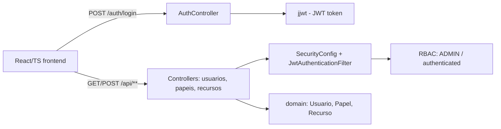

# portal-cliente-oauth2-rbac

**English** · [Português (Brasil)](README.md)

[](#) [](#) [](#) [](#) [](#) [](LICENSE)

## What it is

A **client portal** with **OAuth2/JWT** authentication and **RBAC** (Role-Based Access Control). A Spring Boot 3.4 (Java 21) backend exposes a REST API for authentication and CRUD of users, roles and resources; a React/TS/Vite frontend consumes the API with login and dashboard. A complete study of access security in a web application.

## Status

Working and tested (28 tests, BUILD SUCCESS). Local demo via backend + frontend.

## Features

- **JWT authentication**: login, logout and `/me` (current user).
- **RBAC**: endpoints protected by role (`/api/admin/**` requires `ROLE_ADMIN`; `GET /api/usuarios` admin only; other `/api/**` authenticated).
- **CRUD of roles, resources and users** (`PapelController`, `RecursoController`, `UsuarioController`).
- **React/TS/Vite frontend**: login page, navigation and dashboard.
- **Security**: `SecurityConfig` with a JWT filter, CSRF disabled, authorization rules.

## Architecture

Layered backend (controller → service → domain) with Spring Security + JWT (`jjwt`). Frontend in `/frontend` (React + Vite + Tailwind) consumes the API.



## Stack

- Java 21, Spring Boot 3.4.4
- Spring Web, Spring Security, Spring Validation
- jjwt (API/impl/jackson)
- Spring Security Test, JUnit 5
- Frontend: React 18, TypeScript, Vite, Tailwind

## Repository layout

```
portal-cliente-oauth2-rbac/
├── pom.xml · README · BRIEF.md
├── src/main/java/com/kelvinoliveis/portalrbac/
│   ├── controller/       # AuthController, Papel, Recurso, Usuario
│   ├── security/         # SecurityConfig, JwtAuthenticationFilter
│   ├── service/          # Auth, Token, Papel, Recurso, Usuario
│   ├── domain/           # Usuario, Papel, Recurso
│   ├── repository/       # Repositories (in-memory) + Impl
│   └── dto/              # LoginRequest, AuthResponse, roles, etc.
├── src/test/             # 28 tests (controllers + services)
└── frontend/             # React + TS + Vite + Tailwind
```

## Main endpoints

| Method | Route | Access |
|--------|-------|--------|
| POST | `/auth/login` | public |
| POST | `/auth/logout` | authenticated |
| GET | `/auth/me` | authenticated |
| GET/POST | `/api/papeis` `/api/papeis/{id}` | authenticated |
| GET/POST | `/api/recursos` `/api/recursos/{id}` | authenticated |
| GET/POST | `/api/usuarios` `/api/usuarios/{id}` | `GET` requires ADMIN |

## Prerequisites and installation

- JDK 21, Maven 3.9+ (backend)
- Node.js (frontend)

```bash
git clone https://github.com/KelvinOliveiraCode/portal-cliente-oauth2-rbac.git
cd portal-cliente-oauth2-rbac
```

## How to run

```bash
# backend
./mvnw spring-boot:run        # API at http://localhost:8080

# frontend (another terminal)
cd frontend && npm install && npm run dev
```

To run the tests:

```bash
./mvnw test
```

## Tests and quality

Real command (verified by the agent, Maven 3.9.16 / JDK 21):

```bash
mvn -B test
# Tests run: 28, Failures: 0, Errors: 0 — BUILD SUCCESS
# (AuthController 2, AuthService 4, Papel 6, Recurso 5, Token 3, Usuario 7, +1)
```

There is no CI configured (the `frontend/` folder has committed build/install logs — see `HYGIENE.md`).

## Technical decisions and trade-offs

- **Stateless JWT** for authentication: scales without server sessions; in exchange, token revocation is limited.
- **Role-based RBAC** instead of granular per-resource permissions: simple and readable; the cost is less flexibility for refined policies.
- **Custom JWT filter** (`JwtAuthenticationFilter`) injected before Spring Security's default auth filter.

## Known limitations and roadmap

- JWT tokens without a refresh/revocation strategy in the current delivery.
- **In-memory persistence** (`ConcurrentHashMap` in the repositories; no database/datasource) — data is lost on restart.
- Committed build/install logs under `frontend/` should move to `.gitignore` (see `HYGIENE.md`).

## Development process

An individual project by Kelvin Oliveira, built with orchestrated AI agents and reviewed by the author. The access-security architecture (OAuth2/JWT/RBAC) and the review are the author's.

## License and author

MIT — Copyright (c) 2026 Kelvin Rebelo de Oliveira.

**Author**: [Kelvin Oliveira](https://github.com/KelvinOliveiraCode) · [Portfolio](https://kelvinoliveiracode.github.io/portfolio/)
