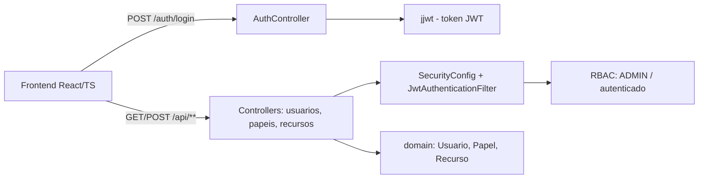

# portal-cliente-oauth2-rbac

[English](README.en.md) · **Português (Brasil)**

[](#) [](#) [](#) [](#) [](#) [](LICENSE)

## O que é

**Portal de clientes** com autenticação **OAuth2/JWT** e controle de acesso **RBAC** (Role-Based Access Control). Backend Spring Boot 3.4 (Java 21) expõe API REST de autenticação e CRUD de usuários, papéis e recursos; frontend React/TS/Vite consome a API com login e dashboard. Um estudo completo de segurança de acesso em aplicação web.

## Status

Funcional e testado (28 testes, BUILD SUCCESS). Demo local via backend + frontend.

## Funcionalidades

- **Autenticação JWT**: login, logout e `/me` (usuário atual).
- **RBAC**: endpoints protegidos por papel (`/api/admin/**` exige `ROLE_ADMIN`; `GET /api/usuarios` só admin; demais `/api/**` autenticados).
- **CRUD de papéis, recursos e usuários** (controllers `PapelController`, `RecursoController`, `UsuarioController`).
- **Frontend React/TS/Vite**: página de login, navegação e dashboard.
- **Segurança**: `SecurityConfig` com filtro JWT, CSRF desabilitado, regras de autorização.

## Arquitetura

Backend em camadas (controller → service → domain) com Spring Security + JWT (`jjwt`). Frontend em `/frontend` (React + Vite + Tailwind) consome a API.



## Stack

- Java 21, Spring Boot 3.4.4
- Spring Web, Spring Security, Spring Validation
- jjwt (API/impl/jackson)
- Spring Security Test, JUnit 5
- Frontend: React 18, TypeScript, Vite, Tailwind

## Estrutura do repositório

```
portal-cliente-oauth2-rbac/
├── pom.xml · README · BRIEF.md
├── src/main/java/com/kelvinoliveis/portalrbac/
│   ├── controller/       # AuthController, Papel, Recurso, Usuario
│   ├── security/         # SecurityConfig, JwtAuthenticationFilter
│   ├── service/          # Auth, Token, Papel, Recurso, Usuario
│   ├── domain/           # Usuario, Papel, Recurso
│   └── dto/              # LoginRequest, AuthResponse, papéis, etc.
├── src/test/             # 28 testes (controllers + services)
└── frontend/             # React + TS + Vite + Tailwind
```

## Endpoints principais

| Método | Rota | Acesso |
|--------|------|--------|
| POST | `/auth/login` | público |
| POST | `/auth/logout` | autenticado |
| GET | `/auth/me` | autenticado |
| GET/POST | `/api/papeis` `/api/papeis/{id}` | autenticado |
| GET/POST | `/api/recursos` `/api/recursos/{id}` | autenticado |
| GET/POST | `/api/usuarios` `/api/usuarios/{id}` | `GET` exige ADMIN |

## Pré-requisitos e instalação

- JDK 21, Maven 3.9+ (backend)
- Node.js (frontend)

```bash
git clone https://github.com/KelvinOliveiraCode/portal-cliente-oauth2-rbac.git
cd portal-cliente-oauth2-rbac
```

## Como executar

```bash
# backend
./mvnw spring-boot:run        # API em http://localhost:8080

# frontend (outro terminal)
cd frontend && npm install && npm run dev
```

Para rodar os testes:

```bash
./mvnw test
```

## Testes e qualidade

Comando real (verificado pelo agente, Maven 3.9.16 / JDK 21):

```bash
mvn -B test
# Tests run: 28, Failures: 0, Errors: 0 — BUILD SUCCESS
# (AuthController 2, AuthService 4, Papel 6, Recurso 5, Token 3, Usuario 7, +1)
```

Não há CI configurado (o diretório `frontend/` contém logs de build/install commitados — ver `HYGIENE.md`).

## Decisões técnicas e trade-offs

- **JWT stateless** para autenticação: escala sem sessão no servidor; em troca, revogação de token é limitada.
- **RBAC por papel** em vez de permissões granulares por recurso: simples e legível; o custo é menos flexibilidade em políticas refinadas.
- **Filtro JWT customizado** (`JwtAuthenticationFilter`) injetado antes do filtro de autenticação padrão do Spring Security.

## Limitações conhecidas e roadmap

- Tokens JWT sem estratégia de refresh/revogação na entrega atual.
- Persistência **em memória** (`ConcurrentHashMap` nos repositórios; sem banco/datasource) — dados se perdem ao reiniciar.
- Logs de build/install commitados em `frontend/` devem ir para `.gitignore` (ver `HYGIENE.md`).

## Processo de desenvolvimento

Projeto individual de Kelvin Oliveira, construído com agentes de IA orquestrados e revisado pelo autor. A arquitetura de segurança (OAuth2/JWT/RBAC) e a revisão são do autor.

## Licença e autor

MIT — Copyright (c) 2026 Kelvin Rebelo de Oliveira.

**Autor**: [Kelvin Oliveira](https://github.com/KelvinOliveiraCode) · [Portfólio](https://kelvinoliveiracode.github.io/portfolio/)
